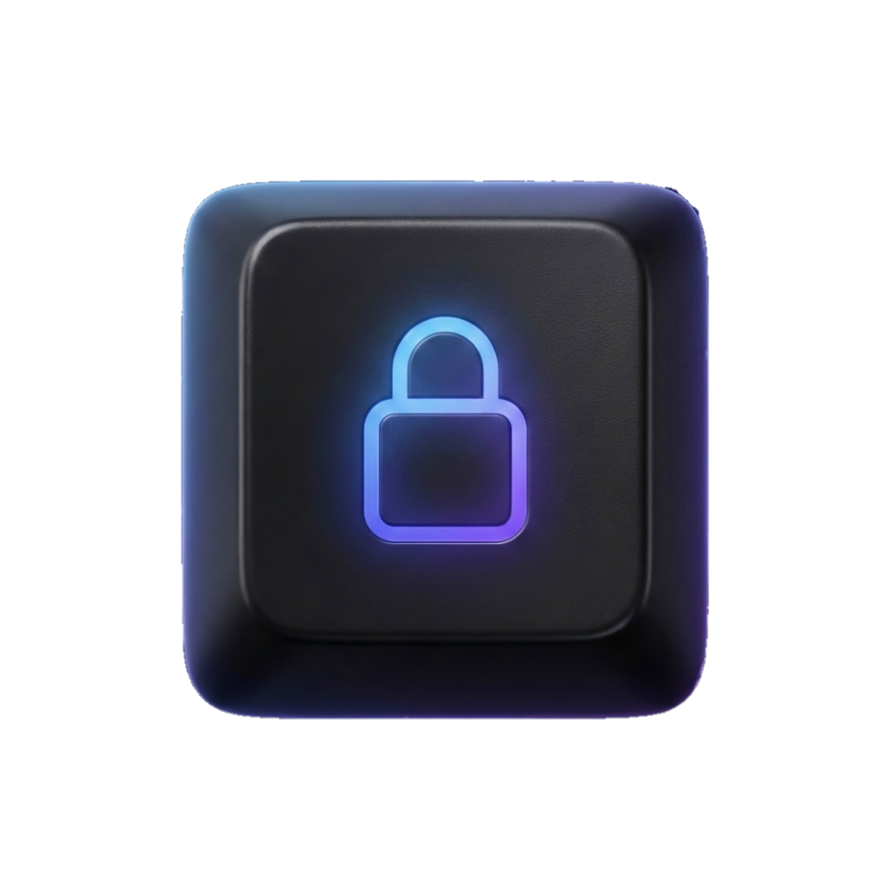

<div align="center">
  
  
  # Crypto Keyboard
  
  ### Invisible Encrypted Messaging for Android
  
  **Send encrypted messages that look completely normal**
  
  [](LICENSE)
  [](https://www.android.com/)
  []()
  [](https://github.com/florisboard/florisboard)
  
  [How It Works](#-how-it-works) • [Features](#-features) • [Installation](#-installation) • [Security](#-security)
  
</div>

---

## 🎯 What Is This?

Crypto Keyboard is an Android keyboard that enables **steganographic encrypted messaging** — hiding encrypted messages inside innocent-looking text.

Your message looks like this to everyone else:
```
"ok 👍"
```

But contains this hidden encrypted message:
```
"Meeting moved to the safehouse at midnight. Bring the documents."
```

The encrypted content is embedded using invisible Unicode characters that most messaging apps preserve. Your recipient's device automatically detects and decrypts the hidden message, displaying it as an overlay.

**No one knows what you're communicating secretly** — not the messaging app, not the server, not surveillance systems.

---

## 🔄 How It Works

### Sending

```
You type secret message → Keyboard encrypts (AES-256-GCM) 
→ Converts to invisible characters → Wraps in cover message 
→ Sends: "ok 👍" [+ hidden encrypted data]
```

### Receiving

```
Encrypted message appears on screen → Accessibility Service detects hidden data 
→ Extracts and decrypts → Shows overlay with real message
```

Works across **some messaging app**: Telegram, Arattai, etc.,

---

## ✨ Features

### Core Functionality

**Encryption**
- AES-256-GCM authenticated encryption
- Random IV per message (no pattern analysis possible)
- 256-bit cryptographic keys
- Key fingerprinting for multi-contact support

**Steganography**
- 16 invisible Unicode characters for encoding
- Distributed embedding (hidden data between visible characters)
- Platform compatibility testing built-in
- Message size estimation and warnings

**Keyboard Integration**
- CRYPTO/NORMAL mode toggle
- Secret message field (your real message)
- Cover message field (what everyone sees)
- Auto-generated cover messages (contextual, casual, emoji)
- One-tap encrypt and send

**Auto-Decryption (Exchange Mode)**
- Accessibility Service scans on-screen text
- Automatic detection of hidden messages
- Overlay display of decrypted content
- Position tracking during scrolling
- Decryption cache for performance

**Key Management**
- QR code key exchange (scan to add contacts)
- PIN-protected key storage
- Password-protected backup/restore
- 32-word recovery phrases
- Multiple keys for different contacts

**Additional Tools**
- Clipboard decryption
- Compatibility tester (checks which invisible chars work on your platform)
- Message length calculator
- Cover message generator

---

## 📥 Installation

### Requirements
- Android 8.0 (Oreo) or newer
- ~25MB storage
- Accessibility permission (for auto-decryption feature)
- Play Protect on Playstore needs to be turned off before installing

### From Source

```bash
git clone https://github.com/martinknox-dev/crypto-keyboard.git
cd crypto-keyboard
./gradlew assembleDebug
adb install app/build/outputs/apk/debug/app-debug.apk
```

### Setup

1. **Enable keyboard**
   - Settings → System → Languages & input → On-screen keyboard
   - Enable "Crypto Keyboard"

2. **Create your key**
   - Open Crypto Keyboard app
   - Key Management → Create New Key
   - Set a label (e.g., "Alice", "Work Group")
   - Back up your 32-word recovery phrase

3. **Exchange keys with contacts**
   - Show your QR code to contact
   - Scan their QR code
   - Verify fingerprint (compare first 8 characters)

4. **Enable auto-decryption (optional)**
   - Settings → Accessibility → Crypto Keyboard
   - Enable service

---

## 🎮 How to Use

### Sending Encrypted Messages

1. Open any messaging app
2. Tap keyboard mode strip → Toggle **CRYPTO** on
3. Tap **🔒 Secret** field
4. Type your hidden message
5. (Optional) Tap **👁 Cover** field and type cover message, or tap **⚡ Auto**
6. Tap **🔒 Send**

Message is encrypted, embedded, and sent automatically.

### Receiving Encrypted Messages

**With Exchange Mode ON:**
- Hidden messages auto-decrypt
- Decrypted text appears as green overlay
- Tap overlay to dismiss

**Without Exchange Mode (manual):**
- Long-press message → Copy
- Open keyboard
- Tap **📋🔓** (clipboard decrypt button)
- Read decrypted message

### Switching Between Contacts

- Tap **🔑 [Name]** pill to cycle through keys
- Long-press to see full key list

---

## 🔐 Security

### Cryptographic Design

| Component | Implementation |
|-----------|----------------|
| Encryption | AES-256-GCM |
| Key size | 256 bits |
| IV | 96 bits, random per message |
| Authentication tag | 128 bits (GCM) |
| PIN protection | SHA-256, 10k iterations |
| Export encryption | PBKDF2-HMAC-SHA256, 100k iterations |

### Message Format

```
[1 byte version][4 bytes key fingerprint][12 bytes IV][N bytes ciphertext + tag]
```

### Steganographic Encoding

Each byte is split into two 4-bit nibbles, each encoded as one of 16 invisible Unicode characters:

```
U+200B, U+200C, U+200D, U+2060, U+2061, U+2062, U+2063, U+2064,
U+206A, U+206B, U+206C, U+206D, U+206E, U+206F, U+FEFF, U+00AD
```

Signature markers (`U+2069 U+2068 U+2069 U+2068`) delimit the payload.

### What This Protects Against

✅ **Passive surveillance** — Messages look innocent  
✅ **Server-side inspection** — Encrypted content is unreadable  
✅ **Message tampering** — GCM authentication detects modifications  
✅ **Shoulder surfing** — Cover message is what's visible  
✅ **Forensic analysis** — Keys are PIN-encrypted on device

### What This Doesn't Protect Against

❌ **Compromised device** — If your phone is hacked, all bets are off  
❌ **Screen recording malware** — Can capture decrypted overlays  
❌ **Metadata** — Who you talk to, when, and frequency is visible  
❌ **Statistical analysis** — Sophisticated detection can identify steganography  
❌ **Quantum attacks** — Not post-quantum resistant (yet)

### Known Limitations

⚠️ **Not professionally audited** — Use for privacy, not life-or-death situations  
⚠️ **Platform dependent** — Some apps strip invisible characters (use compatibility tester)  
⚠️ **Message length limits** — Long secrets = many invisible chars (may hit app limits)  
⚠️ **Accessibility permission** — Required for auto-decryption (broad access)

---

## ⚠️ Important Warnings

### Security

```
⚠️  NOT AUDITED — Cryptographic implementation has not been professionally reviewed
⚠️  BETA SOFTWARE — May contain security vulnerabilities
⚠️  NOT FOR HIGH-RISK USE — Don't rely on this for life-threatening situations
⚠️  STEGANOGRAPHY IS DETECTABLE — Advanced analysis can identify hidden messages
```

### Legal

- **Know your local laws** — Encryption is restricted/illegal in some countries
- **Respect platform Terms of Service** — Some apps prohibit hidden content
- **Don't use for illegal purposes** — This is a privacy tool, not a crime tool

### Operational Security

- **Verify keys in person** — QR codes can be intercepted; verify fingerprints face-to-face
- **Use separate keys** — Don't reuse the same key for multiple contacts
- **Test compatibility first** — Some platforms strip invisible characters
- **Keep cover messages natural** — "asdfghjkl" draws attention; "ok" doesn't
- **Understand metadata limits** — This hides content, not communication patterns

---

## 🏗️ Technical Architecture

### Module Overview

```
app/src/crypto/kotlin/com/mkcreations/cryptokeyboard/
├── crypto/
│   ├── CryptoEngine.kt          # AES-256-GCM encryption/decryption
│   ├── InvisibleEncoder.kt      # Steganographic encoding
│   ├── MessageProcessor.kt      # High-level encrypt/decrypt API
│   ├── KeyGenerator.kt          # Key generation, word phrases
│   ├── CoverGenerator.kt        # Cover message generation
│   ├── DecryptCache.kt          # In-memory decryption cache
│   ├── PinHasher.kt             # PIN hashing for key protection
│   ├── KeyExporter.kt           # Encrypted key backup
│   ├── QrCodeHelper.kt          # QR code generation/parsing
│   └── CompatibilityTester.kt   # Platform testing
├── accessibility/
│   ├── CryptoAccessibilityService.kt  # Main accessibility service
│   ├── ScreenScanner.kt               # Detect encrypted messages
│   └── OverlayManager.kt              # Display decrypted overlays
├── storage/
│   └── SecureKeyStore.kt        # Android Keystore integration
├── model/
│   ├── CipherKey.kt
│   └── CoverStyle.kt
└── ime/
    └── CryptoBarHook.kt         # Keyboard UI integration
```

### Data Flow

**Encryption:**
```
User Input → CryptoBarHook (UI) → MessageProcessor → CryptoEngine → InvisibleEncoder → Output
```

**Decryption:**
```
Screen Text → ScreenScanner → InvisibleEncoder (extract) → CryptoEngine → OverlayManager → Display
```

---

## 🧪 Compatibility Testing

Different messaging platforms handle invisible characters differently. Use the built-in tester:

1. Open Crypto Keyboard app
2. Tools → Compatibility Test
3. Copy test message
4. Send to yourself on target platform
5. Copy received message back
6. Paste into app to analyze results

**Results:**
- **Excellent (16+ chars)** — Full encoding works
- **Good (8-15 chars)** — Encoding works, slightly longer messages
- **Moderate (4-7 chars)** — Basic encoding possible
- **Limited (2-3 chars)** — Very long messages
- **Poor (0-1 chars)** — Use "No Cover" mode (raw Base64)

### Tested Platforms

| Platform | Status |
|----------|--------|
| Telegram | ✅ Excellent |
| WhatsApp | ⚠️ Works with Copy-Paste |
| Signal | ⚠️ Works with Copy-Paste|
| SMS | ⚠️ Works with Copy-Paste |
| Discord | ⚠️ Works with Copy-Paste |
| Facebook Messenger | ⚠️ Works with Copy-Paste |
| Arattai | ⚠️ Wroks but UI fixes needed for Overlay |

---

## 🛠️ Building from Source

### Prerequisites

- Android Studio Hedgehog (2023.1.1) or newer
- If you want a light-weight set-up go with CLI (advanced-users-only)
- JDK 17
- Android SDK 33+
- Git

### Build Steps

```bash
# Clone
git clone https://github.com/martinknox-dev/crypto-keyboard.git
cd crypto-keyboard

# Build debug APK
./gradlew assembleDebug

# Build release APK (requires signing config)
./gradlew assembleRelease

# Run tests
./gradlew test
./gradlew connectedAndroidTest
```

### Project Structure

```
crypto-keyboard/
├── app/
│   ├── src/
│   │   ├── main/           # FlorisBoard integration
│   │   └── crypto/         # Crypto modules
│   └── build.gradle
├── docs/                   # Documentation
├── .github/                # CI/CD
└── README.md
```

---

## 📚 Documentation

- [Security Policy](SECURITY.md) — Threat model, audit status, responsible disclosure
- [Contributing Guidelines](CONTRIBUTING.md) — How to contribute code
- [Roadmap](ROADMAP.md) — Development plans
- [Architecture](docs/ARCHITECTURE.md) — Technical deep dive
- [API Reference](docs/API.md) — Developer documentation

---

## 🗺️ Roadmap

### Current: v0.6-beta

**Status:** Core functionality complete, needs testing and polish

**Working:**
- ✅ Full encryption/decryption pipeline
- ✅ Steganographic encoding
- ✅ Keyboard UI integration
- ✅ Auto-decryption via Accessibility Service
- ✅ Multi-key support
- ✅ QR code key exchange

**In Progress:**
- 🚧 UI polish and animations
- 🚧 Battery optimization
- 🚧 Error handling improvements

### v1.0 Goals

- [ ] Professional security audit
- [ ] Platform compatibility verified (top 10 messengers)
- [ ] Comprehensive documentation
- [ ] Pre-built signed APK releases
- [ ] Panic/wipe functionality
- [ ] Improved key verification UX

### Future Ideas

- Perfect forward secrecy
- Post-quantum encryption
- Group messaging support
- File/image encryption
- Cross-platform (iOS)

See [ROADMAP.md](ROADMAP.md) for details.

---

## 🤝 Contributing

Contributions welcome! This project needs:

- **Security review** — Audit cryptographic implementation
- **Platform testing** — Test on different messengers
- **UI/UX improvements** — Better onboarding, accessibility
- **Documentation** — Improve guides and code comments
- **Bug reports** — Help identify issues

See [CONTRIBUTING.md](CONTRIBUTING.md) for guidelines.

---

## 🐛 Bug Reports

Found a bug? Please open an issue with:

- Device model and Android version
- App version
- Steps to reproduce
- Expected vs actual behavior
- Logs (if available)

**Security vulnerabilities:** Email [YOUR_EMAIL] instead of opening public issue.

---

## 📜 License

```
Copyright 2025 Crypto Keyboard Contributors
Copyright 2020-2026 The FlorisBoard Contributors

Licensed under the Apache License, Version 2.0 (the "License");
you may not use this file except in compliance with the License.
You may obtain a copy of the License at

    http://www.apache.org/licenses/LICENSE-2.0

Unless required by applicable law or agreed to in writing, software
distributed under the License is distributed on an "AS IS" BASIS,
WITHOUT WARRANTIES OR CONDITIONS OF ANY KIND, either express or implied.
See the License for the specific language governing permissions and
limitations under the License.
```

Full license text: [LICENSE](LICENSE)

---

## 🙏 Acknowledgments

### Built On

- **[FlorisBoard](https://github.com/florisboard/florisboard)** by Patrick Goldinger — Excellent keyboard foundation
- **Android Jetpack** — Modern Android development tools
- **[ZXing](https://github.com/zxing/zxing)** — QR code library

### Inspired By

- **[Stegcloak](https://github.com/KuroLabs/stegcloak)** — Text steganography concepts
- **Signal Protocol** — Modern encryption design patterns
- **PGP/GPG** — Public key cryptography principles

### Thanks

To everyone who:
- Tested beta versions
- Reported bugs
- Suggested features
- Contributed code
- Spread the word

---

## 🔗 Links

- **Repository:** https://github.com/martinknox-dev/crypto-keyboard
- **Issues:** https://github.com/martinknox-dev/crypto-keyboard/issues
- **Discussions:** https://github.com/martinknox-dev/crypto-keyboard/discussions
- **Releases:** https://github.com/martinknox-dev/crypto-keyboard/releases

---

<div align="center">

## 🔐 Privacy Through Invisibility

*"The best place to hide a message is where no one thinks to look."*

**[Download](https://github.com/martinknox-dev/crypto-keyboard/releases)** • **[Documentation](docs/)** • **[Report Issue](https://github.com/martinknox-dev/crypto-keyboard/issues)**

Made with privacy in mind.

</div>